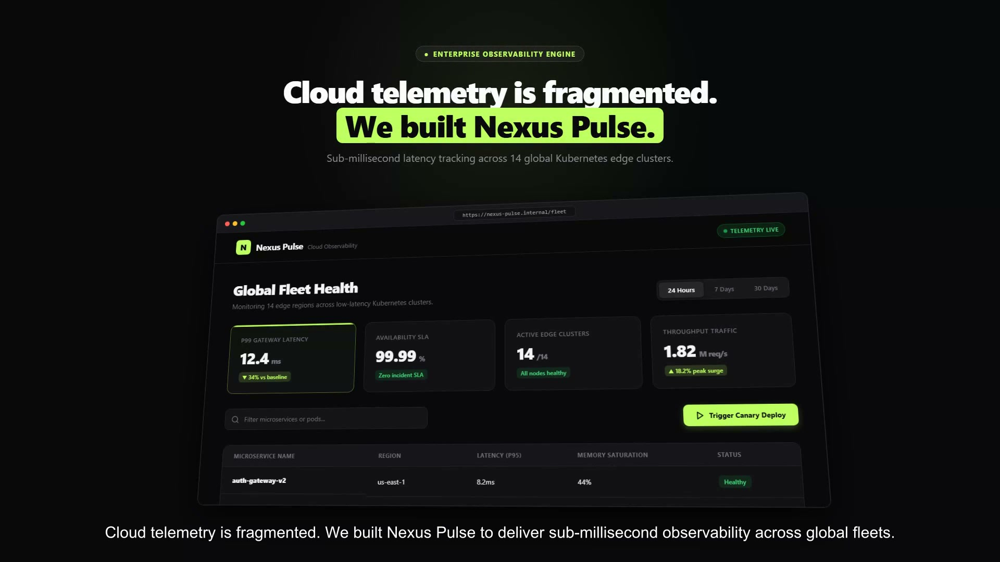

<p align="center">
  
</p>

<h1 align="center">🎬 Walkthrough</h1>

<p align="center">
  <strong>Turn any web app into a narrated product demo video — one storyboard, one command.</strong><br>
  <sub>Built for AI coding agents, CI/CD pipelines, and developers who ship faster than they can record.</sub>
</p>

<p align="center">
  <a href="LICENSE"></a>
  
  
  
  
</p>

<p align="center">
  <a href="#-quickstart">Quickstart</a> •
  <a href="#-ai-agent-skill">Agent Skill</a> •
  <a href="#-storyboard-schema">Storyboard Schema</a> •
  <a href="#-cli">CLI Reference</a> •
  <a href="#-how-it-works">How It Works</a>
</p>

---

## The Problem

You just built a web app. Now you need a demo video for your README, Product Hunt launch, tweet, or PR review. Your options:

1. **Screen recorder** (ScreenStudio, Loom) — manual, breaks every time the UI changes, can't be automated
2. **Write a script** — spend hours wiring Playwright, FFmpeg, TTS, cursor simulation, camera zoom math
3. **Ask your AI agent** — it can build the app, but can't show it to anyone

## The Solution

**Walkthrough** is the missing link. Write a JSON storyboard describing what to click, type, and narrate — and get a polished 1080p demo video with physics-based cursor movement, cinematic camera zooms, neural voiceover, and beat-synced subtitles.

```bash
npx walkthrough build storyboard.json
# → walkthrough-output/walkthrough.mp4 (1080p, narrated, subtitled)
# → walkthrough-output/walkthrough.jpg (poster frame for social)
```

**Or install it as an AI agent skill** and let your coding agent generate the storyboard and video automatically:

```
> /walkthrough — demo the checkout flow
```

---

## ✨ Key Features

| Feature | Details |
|---|---|
| **Physics Cursor** | Perlin `smootherstep` Bézier glide paths with critically-damped spring tracking during camera zoom. Pixel-matched macOS SVG pointer with click depress + ripple feedback. |
| **Viewport-Safe Camera** | Clamped `translate3d + scale` zoom that mathematically guarantees zero black edge gaps. Spotlight vignette + target glow ring on focus. |
| **Neural Voiceover** | `edge-tts` synthesis with smart voice selection (Ava/Andrew). Per-step narration with automatic hold-time pacing. |
| **1080p ASS Subtitles** | `PlayResX:1920 / PlayResY:1080` calibrated typography. Bottom or top placement. Never oversized, never overlapping. |
| **FFmpeg Compositor** | Silence-centered `xfade` dissolves between acts. H.264 `crf 18` + `faststart`. Hero poster extraction. |
| **Multi-Act Structure** | Optional HTML intro/outro template scenes with 3D browser card and terminal receipt compositions. |
| **Cross-Platform** | Auto-detects Chromium, Edge, or Chrome. Works on Windows, macOS, and Linux. |

---

## 🚀 Quickstart

### Prerequisites

| Tool | Version | Check |
|---|---|---|
| Node.js | ≥ 18 | `node --version` |
| Python | ≥ 3.9 | `python --version` |
| FFmpeg | with `libass` | `ffmpeg -filters \| grep ass` |

### Install

```bash
git clone https://github.com/narain-karti/Walkthrough.git
cd Walkthrough
npm install
npx playwright install chromium
pip install -r requirements.txt
```

### Run the Flagship Demo

```bash
npm run demo
```

Outputs `flagship-output/flagship_showcase.mp4` — a 3-act narrated demo of the included Nexus Pulse dashboard (intro card → live walkthrough → receipt outro).

### Build Your Own

Create `storyboard.json`:

```json
{
  "title": "My SaaS Demo",
  "baseUrl": "http://localhost:3000",
  "outputDir": "./demo-output",
  "voice": "female",
  "steps": [
    {
      "desc": "Landing page overview",
      "narration": "Welcome to Acme Dashboard — real-time analytics for modern teams.",
      "holdMs": 4000
    },
    {
      "desc": "Click Create Project",
      "selector": "button#create-project",
      "action": "click",
      "zoom": 1.14,
      "narration": "Creating a new project takes just one click."
    },
    {
      "desc": "Type project name",
      "selector": "input[name='project-name']",
      "action": "type",
      "text": "Q4 Analytics",
      "typeDelay": 75,
      "zoom": 1.14,
      "narration": "Name your project and you're ready to go."
    }
  ]
}
```

```bash
node bin/walkthrough.js build storyboard.json
```

---

## 🤖 AI Agent Skill

Walkthrough ships as a universal AI agent skill. Install it once and any coding agent can generate demo videos autonomously.

### Setup for Antigravity / Gemini CLI

```bash
# Option 1: Copy the skill file
mkdir -p ~/.gemini/config/skills/walkthrough
cp skills/walkthrough/SKILL.md ~/.gemini/config/skills/walkthrough/SKILL.md

# Option 2: Symlink (auto-updates with git pull)
ln -s "$(pwd)/skills/walkthrough" ~/.gemini/config/skills/walkthrough
```

### Setup for Claude Code

```bash
mkdir -p ~/.claude/skills/walkthrough
cp skills/walkthrough/SKILL.md ~/.claude/skills/walkthrough/SKILL.md
```

### Setup for Cursor / Windsurf / Other Agents

Copy `skills/walkthrough/SKILL.md` into whatever directory your agent reads for skill definitions. The skill is a single self-contained markdown file with YAML frontmatter — no special format required.

### Usage

Once installed, trigger naturally in any project:

```
/walkthrough
/walkthrough demo the onboarding flow
/walkthrough record a 30-second pitch of the checkout page
```

The agent will:
1. Inspect your codebase and find the start command + URL
2. Generate a `storyboard.json` with real selectors and narration
3. Run the full `audio → record → render` pipeline
4. Deliver `walkthrough.mp4` + `walkthrough.jpg`

---

## 📋 Storyboard Schema

### Root Fields

| Field | Type | Default | Description |
|---|---|---|---|
| `title` | string | `"Untitled"` | Video title |
| `baseUrl` | string | **required** | Target URL or relative HTML path |
| `outputDir` | string | `./walkthrough-output` | Output folder |
| `outputName` | string | `"walkthrough"` | Base name for `.mp4` / `.jpg` |
| `voice` | string | `"female"` | `"female"`, `"male"`, or full `edge-tts` voice name |
| `cursorStart` | `[x, y]` | `[960, 1120]` | Initial cursor position |
| `intro` | object | — | `{ "template": "intro.html", "narration": "..." }` |
| `outro` | object | — | `{ "template": "outro.html", "narration": "..." }` |

### Step Fields

| Field | Type | Default | Description |
|---|---|---|---|
| `selector` | CSS selector | — | Target element |
| `action` | `"click"` / `"type"` / `"hover"` | — | Interaction type |
| `text` | string | — | Text to type |
| `typeDelay` | ms | `80` | Keystroke delay |
| `zoom` | number | — | Camera zoom scale (e.g. `1.14`) |
| `highlight` | boolean | `true` | Glow ring on zoomed target |
| `narration` | string | — | Voiceover line → audio + subtitle |
| `holdMs` | ms | auto | Hold time (auto-paced from narration if omitted) |
| `cursorOffset` | `[dx, dy]` | `[0, 0]` | Offset from element center |
| `waitFor` | CSS selector | — | Wait for element before proceeding |

### Positioning Controls

- **Cursor start**: `"cursorStart": [960, 540]` in storyboard root
- **Camera zoom**: `"zoom": 1.14` per step — pan auto-clamped to prevent black edges
- **Subtitle position**: CLI `--sub-pos top` or `--sub-pos bottom` or `--no-subtitles`
- **Intro 3D tilt**: CSS vars `--tilt-x`, `--tilt-y`, `--dive-scale` in `templates/act1_intro.html`

---

## 🛠 CLI

```bash
walkthrough build  <storyboard.json>  # Full pipeline: audio → record → render
walkthrough audio  <storyboard.json>  # Synthesize voiceover + timing manifest
walkthrough run    <storyboard.json>  # Record Playwright browser session
walkthrough render <storyboard.json>  # FFmpeg composite + subtitles + poster
walkthrough demo                      # Run flagship 3-act showcase
walkthrough help                      # Show CLI reference
```

| Flag | Description |
|---|---|
| `--voice <name>` | Override TTS voice |
| `--output <dir>` | Override output directory |
| `--url <url>` | Override storyboard baseUrl |
| `--browser <chromium\|msedge\|chrome>` | Browser to use (auto-detected) |
| `--headless <true\|false>` | Headless mode (default: `true`) |
| `--sub-pos <bottom\|top>` | Subtitle vertical placement |
| `--no-subtitles` | Skip burned-in captions |
| `--fps <30\|60>` | Output frame rate |

---

## ⚙️ How It Works

```
  storyboard.json
        │
        ▼
  ┌─────────────┐    ┌──────────────┐    ┌──────────────┐
  │  edge-tts    │───▶│  Playwright   │───▶│   FFmpeg      │
  │  Voiceover   │    │  + Cursor     │    │  Compositor   │
  │  + Timing    │    │  + Camera     │    │  + Subtitles  │
  └─────────────┘    └──────────────┘    └──────────────┘
        │                   │                    │
   voiceover.mp3      raw .webm            walkthrough.mp4
   timing.json        timeline.json        walkthrough.jpg
```

1. **Audio Synthesizer** reads `narration` from each step, calls `edge-tts`, computes exact clip durations and silence-centered crossfade offsets (`timing.json`)
2. **Recorder** launches Playwright with injected cursor physics (smootherstep Bézier + spring tracking) and viewport-safe camera zoom, pacing step holds to narration durations
3. **Compositor** normalizes clips to 1080p H.264, applies `xfade` dissolves inside silence gaps, burns `PlayResX:1920/PlayResY:1080` ASS subtitles, muxes audio, and extracts a poster frame

---

## 📂 Project Structure

```
Walkthrough/
├── bin/walkthrough.js              # CLI entry point (arg parsing + pipeline orchestration)
├── engine/
│   ├── record.js                   # Playwright recorder with cursor/camera injection
│   ├── cursor-overlay.js           # macOS SVG pointer — smootherstep + spring physics
│   ├── camera-engine.js            # Viewport-safe clamped zoom + spotlight vignette
│   ├── audio_synthesizer.py        # Storyboard → edge-tts → timing manifest + subtitles
│   └── compositor.py               # FFmpeg xfade + 1080p ASS subtitles + poster
├── templates/
│   ├── act1_intro.html             # 3D browser card intro (CSS-var configurable)
│   └── act3_outro.html             # Terminal receipt outro
├── demo/index.html                 # Nexus Pulse sample dashboard
├── showcase/
│   ├── storyboard.json             # Flagship 3-act storyboard config
│   ├── walkthrough_demo.mp4        # Pre-rendered demo video
│   └── poster.jpg                  # Poster frame for README/social
├── skills/walkthrough/SKILL.md     # Universal AI agent skill definition
├── tests/verify_positioning.js     # Cursor + camera bounds assertions
├── package.json
├── requirements.txt                # edge-tts
└── LICENSE                         # MIT
```

---

## 🙏 Credits

- Neural voices via [edge-tts](https://github.com/rany2/edge-tts)
- Browser automation via [Playwright](https://playwright.dev)
- Video compositing via [FFmpeg](https://ffmpeg.org)

## 📄 License

MIT — [Narain Karti](https://github.com/narain-karti)
